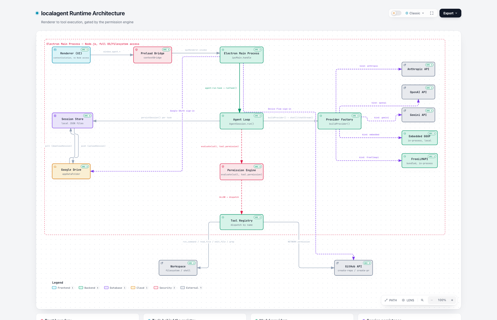

# localagent

**[localagentapp.com](https://www.localagentapp.com)**

localagent is a local-first autonomous coding agent. It runs on macOS and Windows. You bring your own model. You can use any of these:

- A GGUF file that runs entirely on your machine, with no server.
- Any Hugging Face GGUF repository. You find it by search or by path.
- Any OpenAI-compatible server. Examples: Ollama, LM Studio, vLLM, llama.cpp server.
- Claude, OpenAI, or Google Gemini.
- A bundled free-tier router. It connects to about 34 free providers.

localagent gives you a real agent loop. The loop has a permission engine. It has tools for files, search, edits, shell commands, and MCP servers. It has checkpoints and diff review. It falls back to another cloud provider automatically when one hits a rate limit. It supports several session tabs at once. It is a complete desktop app.

Nothing leaves your machine, unless you choose a cloud model yourself.

[](https://github.com/lavuchandu169/localagent/releases)
[](https://github.com/lavuchandu169/localagent/actions/workflows/ci.yml)
[](LICENSE)


Everything in this document is real. It works today. For the list of gaps, see [What's not built yet](#whats-not-built-yet). We state the gaps here. We do not hide them.

## Contents

- [Highlights](#highlights)
- [Quick start](#quick-start)
- [CLI](#cli)
  - [Embedded models](#embedded-models)
- [Desktop app](#desktop-app)
  - [Multi-session tabs](#multi-session-tabs)
  - [MCP servers](#mcp-servers)
  - [Checkpoints, diffs, and file changes](#checkpoints-diffs-and-file-changes)
  - [Custom models: type a path or search Hugging Face](#custom-models-type-a-path-or-search-hugging-face)
  - [Command palette](#command-palette)
  - [First-run onboarding](#first-run-onboarding)
  - [Auto-updates](#auto-updates)
  - [Download the beta](#download-the-beta)
  - [Google sign-in and cloud backup](#google-sign-in-and-cloud-backup)
  - [Using cloud providers (Anthropic / OpenAI / Gemini)](#using-cloud-providers-anthropic--openai--gemini)
  - [Free-tier router (FreeLLMAPI)](#free-tier-router-freellmapi)
  - [Automatic fallback on rate limits](#automatic-fallback-on-rate-limits)
  - [Running inside a sandboxed agent CLI](#running-inside-a-sandboxed-agent-cli)
- [Privacy](#privacy)
- [Testing](#testing)
- [Architecture](#architecture)
- [Project structure](#project-structure)
- [What's not built yet](#whats-not-built-yet)
- [License](#license)

## Highlights

**Agent core**
- A real loop, in `src/agent.ts`. The loop sends messages and tool schemas. It gets back a final answer or tool calls. It checks permission. It runs the tool. It adds the result to the history. It repeats, up to a turn limit. The loop sends out a typed stream of events: `status`, `tool.start`, `tool.result`, `permission.request`, `text`, `done`, `error`. The CLI and the desktop app both show these events live.
- Runtime-enforced grounding. If a task names a real file, the agent reads that file first, before its first turn. Small local models do not reliably do this on their own, from the task text alone.
- Runtime-enforced verification. After a task's edit succeeds, the agent looks for a known test command in the workspace: `npm test`, `pytest`, `cargo test`, or `go test`. If it finds one, it runs that command through the same permission check as any other command. The model must see a real pass or fail result before it can mark the task done. It cannot just claim success on its own.
- **Plan first** (off by default). This holds a task's first move for your approval, before the agent runs it. You do not find out only after the fact.

**Providers — change the backend, keep the same agent**
- **`EmbeddedLlamaProvider`** runs a GGUF model directly inside the app, through `node-llama-cpp`. It needs no server and no other app. It downloads and caches the model on first run. It offers 10 curated models, in three groups: 3 coding models, 4 general chat models, and 3 larger research and reasoning models. Each model shows its real name, grouped by its purpose. The app never hides a model behind a vague label like "small" or "large". Beyond this list, you can also type any `hf:org/repo:quant` Hugging Face path directly. You can also search Hugging Face's GGUF listings from inside the app. See [Custom models](#custom-models-type-a-path-or-search-hugging-face).
- **`OpenAICompatibleProvider`** talks to Ollama, LM Studio, vLLM, or any server with a `/v1/chat/completions` endpoint.
- **`AnthropicProvider`** uses the real Claude API: Sonnet 5, Opus 5, or Haiku 4.5. Use this when you want top model quality and you accept that your code leaves your machine. The status bar shows a live token and cost estimate while it runs.
- **`OpenAIProvider`** uses the real OpenAI API: GPT-5.5, GPT-5.6 Sol, or GPT-5 Nano. Desktop app only.
- **`GeminiProvider`** uses the real Google Gemini API: 2.5 Flash, 2.5 Pro, or 2.5 Flash-Lite. Each has a free tier. Desktop app only.
- **`FreellmapiProxyProvider`** is a bundled, in-process free-tier router. Desktop app only. See [Free-tier router](#free-tier-router-freellmapi).
- **`MockProvider`** is a scripted provider. It needs no network. It is used for tests and the demo.
- **Automatic fallback.** When a configured cloud provider (Anthropic, OpenAI, or Gemini), or the free-tier router, hits a rate limit mid-task, the session retries on the next configured cloud provider. It does not just fail the task. See [Automatic fallback on rate limits](#automatic-fallback-on-rate-limits).

**Tools and safety, checked by code, not by guesswork**
- Tools: `read_file` (reads a full file, or a line range with offset and limit, for a large file); `list_directory`; `grep` (ripgrep, with a pure-JS fallback); `edit_file` (full content for a new file or a large rewrite, or `old_string`/`new_string` for one targeted change, without rewriting the rest of the file); `delete_file` (one file, or a whole directory with `recursive: true`); `run_command`. Every tool an MCP server offers is also available, once you connect that server.
- Every file tool refuses to touch a protected path: `.env*`, `*.pem`, `*.key`, `id_rsa*`, `credentials.*`, `secrets.*`, `.ssh/`, `.aws/`, `.git/`. Every file tool also redacts text that looks like a secret, before that text ever reaches the model or your terminal.
- `PermissionEngine` is deterministic code. It is not an LLM's judgment. It has four modes: `PLAN`, `DEFAULT`, `ACCEPT_EDITS`, `AUTO_SAFE`. It also classifies commands by risk: `SAFE_READ`, `NETWORK`, `DESTRUCTIVE`, `UNKNOWN`. An `UNKNOWN` command always asks for your approval. If a model proposes a full-file rewrite of a file it never read, the engine asks for your approval too, even in an auto-approve mode. Every MCP tool call asks for your approval, in every mode, the same as a shell command does.
- **Per-hunk diff approval.** An edit the agent proposes shows you the real colored diff before you approve it. Each changed section has its own checkbox. Uncheck a section you do not want. Only the checked sections get written to disk.
- **Checkpoints and revert.** Before a task's first write or command, in a git workspace, the agent takes a snapshot of the whole workspace. It does this with a scratch git index. This index never touches your real index, your `HEAD`, or your branch. Revert restores everything, including files the task created, by removing them again. A "Files changed" view lists every change since the checkpoint, with full diffs, in one place.

**Desktop app**
- A Mac and Windows Electron shell sits around the same core. `agent.ts` did not need to change for this. The app has a workspace picker, a provider and mode selector, a task input box (with file and image attachments), and a live event log with inline Approve and Deny buttons. It offers four themes: two dark IDE-style themes (Warm Dark and Mono Ink), one OLED Black theme, and one Light theme. It has smooth entrance and transition animations throughout.
- **Multi-session tabs.** Run up to 6 sessions at once. Each one keeps running and updating in the background, even when you are not looking at it.
- **A command palette** (Ctrl+K or Cmd+K). Type to jump to any saved session, or to open a panel. You do not need to search through the sidebar.
- **Session history.** Every finished task saves itself automatically. A sidebar lists past sessions and searches their full text. Resuming a session restores its full model context. It is not just a read-only transcript.
- **MCP client support.** Connect local MCP servers: a GitHub server, a Postgres server, or any server that speaks the protocol. Their tools then appear next to the built-in tools.
- **Optional Google sign-in.** It gates nothing: the app works fully when you are signed out. When you sign in, the app turns on automatic backup to a hidden folder in your Google Drive. Your history then survives a reinstall, or a move to a new machine. The backup is filtered per account, the same as in any multi-user app. (This sign-in option is currently hidden from the UI. See the note at the top of [Google sign-in and cloud backup](#google-sign-in-and-cloud-backup).)
- **Auto-updates.** A new version downloads itself in the background. It then offers a one-click restart. If that cannot finish (expected before code-signing is in place), the app falls back to a manual download.

## Quick start

```bash
npm install
npm run build

# Offline, no LLM required — proves the whole harness works end-to-end:
npm run demo

# Full test suite:
npm test
```

`npm run demo` runs against `fixture-repo/`. This is a small repo with a broken `add()` function and a failing test, made broken on purpose. A scripted fake model reads the file. It runs the failing test. It fixes the bug. It runs the test again. It reports success only after it sees a real exit code of `0`. This proves the loop, the tools, and the permission gate all work together, with no real LLM involved.

## CLI

```bash
# Embedded mode — no server, no other app. Downloads and caches a GGUF
# model on first run (default: Qwen2.5-Coder-1.5B-Instruct, ~1GB) into
# node-llama-cpp's default models directory, ~/.node-llama-cpp/models —
# delete that folder to clear the cache, or pre-seed it before going air-gapped.
node dist/cli.js "explain how add() works in math.js" \
  --workspace ./fixture-repo \
  --mode DEFAULT

# Against an external server (e.g. `ollama pull qwen2.5-coder` first):
node dist/cli.js "explain how add() works in math.js" \
  --workspace ./fixture-repo \
  --base-url http://localhost:11434/v1 \
  --model qwen2.5-coder:latest \
  --mode DEFAULT

# The real Claude API instead — sends code over the network, needs ANTHROPIC_API_KEY:
node dist/cli.js "explain how add() works in math.js" \
  --workspace ./fixture-repo \
  --provider anthropic \
  --mode DEFAULT
```

| Flag | Meaning |
|---|---|
| `--workspace <dir>` | The repo root the agent's file tools work in |
| `--base-url <url>` | Use an OpenAI-compatible server, instead of the embedded model |
| `--model <name>` | A server model id, with `--base-url`. Otherwise, one of the 10 embedded model ids (default `qwen-coder-1.5b`). Run with no arguments to see the full list. |
| `--provider anthropic` | Use the real Claude API. Needs `ANTHROPIC_API_KEY`. |
| `--mode <mode>` | The permission mode. See the table below. |

| Mode | Reads | Edits | Shell commands |
|---|---|---|---|
| `PLAN` | ✅ free | 🚫 refused | 🚫 refused |
| `DEFAULT` | ✅ free | ⏸ asks | ⏸ asks |
| `ACCEPT_EDITS` | ✅ free | ✅ auto | ⏸ asks |
| `AUTO_SAFE` | ✅ free | ✅ auto | ✅ auto *(only the project's own exact test/verify command — `npm test`, `pytest`, `cargo test`, `go test ./...`; everything else still asks)* |

The custom Hugging Face path and search feature, described below, works in the desktop app only. The CLI's `--model` flag only accepts the curated ids.

### Embedded models

Every embedded model is GGUF format, `Q4_K_M` quantization, resolved through `node-llama-cpp`'s `resolveModelFile()`. The desktop app shows the **Name** column, grouped by **Purpose**. The `--model` flag takes the id.

| Id | Name | Purpose | Note |
|---|---|---|---|
| `qwen-coder-1.5b` | Qwen2.5-Coder 1.5B Instruct | Coding | fastest, lowest memory — default — can be unreliable on complex, multi-file changes |
| `qwen-coder-3b` | Qwen2.5-Coder 3B Instruct | Coding | better quality, more memory — can be unreliable on complex, multi-file changes |
| `qwen-coder-7b` | Qwen2.5-Coder 7B Instruct | Coding | best quality, needs a capable machine |
| `qwen-3b` | Qwen2.5 3B Instruct | Chat | fast, general-purpose |
| `llama-3.2-3b` | Llama 3.2 3B Instruct | Chat | fast, general-purpose |
| `phi-3.5-mini` | Phi-3.5 Mini Instruct | Chat | compact, strong reasoning for its size |
| `mistral-7b` | Mistral 7B Instruct v0.3 | Chat | best quality, needs a capable machine |
| `qwen-14b` | Qwen2.5 14B Instruct | Research & Reasoning | ~9GB download, strong general reasoning |
| `deepseek-r1-distill-qwen-14b` | DeepSeek-R1-Distill-Qwen 14B | Research & Reasoning | ~9GB download, reasoning-distilled — best for research/analysis |
| `qwen-32b` | Qwen2.5 32B Instruct | Research & Reasoning | ~20GB download, most capable local option — needs a powerful machine |

The app picks a recommended model for your hardware automatically. It marks this choice with a "recommended for this machine" tag in the desktop app. It picks from the 3 coding models, by your RAM: under 8GB gets `qwen-coder-1.5b`; 8 to 16GB gets `qwen-coder-3b`; 16GB or more gets `qwen-coder-7b`. On a machine's very first launch, the dropdown starts on this recommended model too. See [First-run onboarding](#first-run-onboarding). On later launches, the app never overrides a choice you already made. You pick a Chat or a Research/Reasoning model yourself; the app does not recommend one of these.

The prebuilt installers include GPU acceleration: Vulkan for NVIDIA, AMD, and Intel GPUs on Windows and Linux, and Metal for Apple Silicon on macOS. The app detects your hardware automatically. It offloads layers to the GPU when one is available. It falls back to the CPU otherwise, so nothing breaks either way. The installers leave out `node-llama-cpp`'s separate CUDA backend on purpose. On top of Vulkan, this backend would add about 500MB, mostly for an NVIDIA-only fallback binary. Vulkan already covers more hardware than this backend does. If you build from source with that package installed, your build will include it.

## Desktop app

```bash
npm run build      # also copies src/electron's static assets into dist/electron/
npm run electron
```

Pick a workspace, for example `fixture-repo`. Choose a provider. Pick a mode. Type a task. Select **Run**. The event log shows tool calls and results live, with inline Approve and Deny buttons for anything the permission engine asks about. Past sessions stay in the left sidebar. You can search them and resume them with their full context.

### Multi-session tabs

Open up to 6 sessions at once, in a real tab strip. Each tab keeps running and updating in the background, whether or not you are looking at it. You lose no progress, and the app does not reload when you switch back to a tab. Each tab shows a status dot: running, waiting on your approval, done, or failed. The dot pulses while the session is active, so you can see at a glance what needs your attention. Closing a tab never stops the session behind it. You can reopen that session at any time, from the sidebar or the command palette.

### MCP servers

Connect the agent to local MCP servers: a GitHub server, a Postgres server, or any server that speaks the protocol. Do this from the MCP Servers panel (the 🔌 icon). Every tool a connected server offers then appears next to the built-in tools. Every call to a connected server's tool asks for your approval first, in every permission mode, the same as a shell command does.

### Checkpoints, diffs, and file changes

Before a task's first write or command, in a git workspace, the app takes a snapshot of the whole workspace: tracked files and untracked files both. It stores this snapshot as a real git commit, through a scratch index. This never touches your actual index, your `HEAD`, or your branch. "Revert this task" restores everything back to that snapshot, including removing any files the task created since then. A "Changes" button opens a GitHub-style view of every file touched since the checkpoint, each with its full diff.

Every proposed edit shows you the real colored diff before you approve it. Each changed hunk has its own checkbox, checked by default. Uncheck the hunks you do not want. Only the checked hunks get written to disk.

### Custom models: type a path or search Hugging Face

Beyond the 10 curated models, the Model dropdown has a "Custom local model (Hugging Face GGUF)…" option. Use it to type any `hf:org/repo:quant` path directly. The app downloads and runs this model exactly like a curated one. You need no app update to try something new. A search box above the field queries Hugging Face's GGUF listings directly. Type a keyword, select a result, and the app fills in the path for you. It defaults to the `Q4_K_M` quant; you can edit this if a repo does not ship that quant. Unlike the curated list, the app runs no quality check and no tool-call-format check on a custom model.

### Command palette

Open it with Ctrl+K or Cmd+K, or the 🔎 icon in the activity bar. Type to jump to any saved session, or to open Settings, About, or MCP Servers. Use the arrow keys to move, and Enter to select. The palette only navigates; it does not change a running session's own settings, such as its model or a checkpoint revert. For those actions, use the session's own form UI.

### First-run onboarding

On a machine's very first launch, the Model dropdown starts on whichever embedded model the hardware runs best, not always the smallest one. On later launches, the app leaves your own choice alone. The very first session also shows a few clickable example tasks above the composer, to help you start. These examples disappear for good after your first real task.

### Auto-updates

A new version downloads itself in the background, with no click needed from you. It then offers a one-click "Restart Now" button. If you do not click it, the update applies itself the next time you quit the app normally. If the in-place update step cannot finish — expected on today's unsigned builds, see below — the app falls back to opening the file it already downloaded, or to the release page as a last resort. This way, auto-update never behaves worse than having no auto-update at all.

### Download the beta

Prebuilt installers are attached to each [GitHub Release](https://github.com/lavuchandu169/localagent/releases). You do not need to run `npm install` or `npm run build`. See [`CHANGELOG.md`](CHANGELOG.md) for what changed in each release.

These are unsigned builds. There is no Apple Developer certificate and no Windows code-signing certificate behind them yet. Your OS shows a one-time warning on first launch. This is normal for a beta. It is not a sign that something is wrong.

- **macOS**: Gatekeeper blocks the app and says it "cannot be opened because the developer cannot be verified". Right-click the app, select **Open**, then confirm in the dialog. You only need to do this once.
- **Windows**: SmartScreen shows "Windows protected your PC". Select **More info**, then **Run anyway**. You only need to do this once.

This beta's macOS build supports Apple Silicon (arm64) only. Intel Mac (x64) support is not available yet.

Google sign-in and Drive backup both work in the packaged installers, with no setup from you. The official `.dmg` and `.exe` downloads ship with a working Client ID built in. The UI to reach this sign-in is currently hidden. See the note under [Google sign-in and cloud backup](#google-sign-in-and-cloud-backup) below. The rest of that section describes how the feature works, once the UI is visible again. If you would rather use your own Google Cloud project, with your own quota and your own consent screen, the `.env` route described below still works, regardless of the UI's current state.

### Google sign-in and cloud backup

> **Currently hidden from the UI.** The "Sign in with Google" button, and the Settings panel's Google Sign-in section, are both temporarily hidden. Everything below describes how the feature works underneath; that part has not changed. There is just no visible button to reach it right now.

This sign-in is optional. It gates nothing: chat, tasks, and session history all work fully when you are signed out. When you sign in, the app also turns on automatic backup of your session history. It backs up to a private, hidden folder in your Google Drive (`drive.appdata`). This folder is invisible in your normal Drive UI, and it is scoped to this app only. Your history then survives a reinstall or a move to a new machine. The app filters history per signed-in account, the same as any multi-user app keeps your chats separate from others.

This sign-in uses PKCE. By Google's own design for desktop apps, PKCE needs no client secret. In practice, some "Desktop app" client registrations still require one, so the app also supports `GOOGLE_OAUTH_CLIENT_SECRET` when Google asks for it. See the troubleshooting table below. The app encrypts your signed-in refresh token at rest, through your OS's own native credential store: Keychain on macOS, DPAPI on Windows, libsecret on Linux. The app never writes this token to disk as plain text.

Official builds already have a working Client ID built in. You only need the steps below if you build from source, or if you want to use your own Google Cloud project instead of the built-in one. Nothing from your own project is shared with anyone else's project.

1. Go to [console.cloud.google.com](https://console.cloud.google.com/). Create a project, or select an existing one.
2. Open **APIs & Services → OAuth consent screen**. Configure it as External or Internal, with an app name and a support email. While the screen is in **Testing** mode, add your own Google account under **Audience → Test users**. If you skip this step, sign-in fails with `access_denied`.
3. Open **APIs & Services → Library**. Search for **Google Drive API**. Select **Enable**. If you skip this step, backup fails silently, with a `Google Drive API has not been used in project ...` error in the console.
4. Open **APIs & Services → Credentials → Create Credentials → OAuth client ID**. Set Application type to **Desktop app**. Copy the Client ID the console generates.
5. Put your credentials in a `.env` file, in the project root. This file is already gitignored; it is never committed. Do this instead of exporting the variables by hand every time:
   ```bash
   export GOOGLE_OAUTH_CLIENT_ID=your-client-id.apps.googleusercontent.com
   export GOOGLE_OAUTH_CLIENT_SECRET=your-client-secret
   ```
   `npm run electron` loads this file automatically. A variable you already set in your real shell environment always wins over the value in this file.

   If you run the packaged app, instead of building from source, use the in-app Settings panel (the gear icon) instead of a `.env` file. See [Download the beta](#download-the-beta) above.

<details id="troubleshooting">
<summary>Troubleshooting</summary>

| Symptom | Cause | Fix |
|---|---|---|
| `GOOGLE_OAUTH_CLIENT_ID is not set` | No client ID exists: not in the environment, not in `.env`, not in saved Settings, and not in the embedded default (the embedded default only exists for an official build, not a from-source build). | Running from source: see step 5 above. Running an official packaged app: this should not happen, and sign-in should just work. If it does happen, open Settings (the gear icon in the header) and enter a Client ID and Secret there as a workaround. |
| `access_denied` at Google's consent screen | The OAuth consent screen is in Testing mode, and your account is not a test user. | Add yourself under Audience → Test users (step 2). |
| `client_secret is missing` | Google issued this Client ID as a type that needs a secret, even with PKCE. | Set `GOOGLE_OAUTH_CLIENT_SECRET` too. |
| `[cloudSync] upload failed ... Google Drive API has not been used` | The Drive API is not enabled for this project. | Enable it (step 3). Wait about 30 seconds. Try again. |
| Session history does not come back after a reinstall | The uploads never reached Drive. Check your terminal for `[cloudSync]` log lines. | Fix whatever the log line reports. Then sign in again; the next save retries automatically. |
| You are signed in, but backup is silently not happening | Your stored token predates the Drive scope. | Sign in again once, to re-consent. |

</details>

"Sign in with Apple" is a disabled stub. It needs a paid Apple Developer account and a registered web domain. Neither exists for this project yet.

### Using cloud providers (Anthropic / OpenAI / Gemini)

Choosing Cloud gives you Claude (Sonnet 5, Opus 5, or Haiku 4.5), OpenAI (GPT-5.5, GPT-5.6 Sol, or GPT-5 Nano), or Google Gemini (2.5 Flash, 2.5 Pro, or 2.5 Flash-Lite; each with a free tier). Any of these sends your file contents and task context to that provider, over the network. Each needs your own API key, and each is pay-as-you-go, except for Gemini's free tier. Claude here is a separate product from a claude.ai Pro or Max subscription. Anthropic's own terms reserve that subscription's sign-in for Claude Code and claude.ai itself. You cannot use that subscription's sign-in from this app, or from any other third-party app. An API key is the only supported way in. The status bar shows a running token and cost estimate while an Anthropic session is active, at Anthropic's standard API rates. The composer also shows a rough, input-only cost estimate as you type, before you send your task. It computes this from your message's character count, not from a real tokenizer, so treat it as a rough guide, not a bill.

Set the matching environment variable: `ANTHROPIC_API_KEY`, `OPENAI_API_KEY`, or `GEMINI_API_KEY`. A `.env` file works too, if you build from source. You can also add the key in the app's Settings panel (the gear icon). This follows the same rule as Google sign-in's credentials: an environment variable always wins over a saved setting. If you leave `ANTHROPIC_API_KEY` unset, the app falls back to the Anthropic SDK or CLI's own handling, such as `ANTHROPIC_AUTH_TOKEN` or an `ant auth login` profile. This fallback behavior is unchanged.

### Free-tier router (FreeLLMAPI)

Choosing Cloud → **Free-tier router (34 providers, auto-fallback)** bundles [FreeLLMAPI](https://github.com/tashfeenahmed/freellmapi). This project is MIT-licensed, and it is vendored here as a pinned git submodule, in `vendor/freellmapi/`. The app runs its server in-process, inside the app's own Electron process. You do not need a separate install. You do not need a subprocess. You do not need to start anything by hand. This router aggregates about 34 providers' own free API tiers, behind one OpenAI-compatible endpoint. You get real cloud model access, with no API key of your own, and no cost.

Select **Manage free providers…** (shown once you select this option) to open its own dashboard window. This window is already authenticated; you need no separate login. Here you add and manage each provider's own free key, the same way you would in FreeLLMAPI's own standalone app. This router stores its own local SQLite database, under this app's user data directory. It never talks to FreeLLMAPI's own hosted service (`freellmapi.co`). It runs entirely self-hosted, against whichever providers you configure through the dashboard.

### Automatic fallback on rate limits

When the active cloud provider — a configured Anthropic, OpenAI, or Gemini key, or the free-tier router itself — returns a rate-limit response mid-task, the session switches automatically to the next configured cloud provider. It does not just fail the task. You see a status line like `Claude hit a rate limit — retrying on OpenAI...` in the event log. The task continues on the new provider. Fallback candidates come from whichever cloud providers you saved a key for, in the order you first added each key. The free-tier router is not a fallback target; it is only a fallback source. Falling back to the router would not help if the router itself is exhausted.

### Running inside a sandboxed agent CLI

Some sandboxes, for example Claude Code, set `ELECTRON_RUN_AS_NODE=1`. This lets their own bundled Electron binary also work as a plain Node runtime internally. This same environment variable makes any Electron binary skip its app and window setup entirely, and just run the entry file as plain Node. In that case, `import ... from "electron"` fails, or resolves to `{}`, and no window ever opens. This is not a bug in this app. Unset this variable for the `electron` process specifically:

```bash
env -u ELECTRON_RUN_AS_NODE npm run electron
```

A normal user terminal does not have this variable set at all.

## Privacy

This project has no backend. We run no server. We collect no analytics. We send no telemetry. Nothing phones home. Everything below happens directly between your machine and whichever service you explicitly configure.

- **Your code and files** stay on your machine, unless you choose a provider that sends them elsewhere. Claude, OpenAI, and Gemini each send task context to their own API; each needs your own API key for that provider. The free-tier router sends task context to whichever of its ~34 providers handles a given request, but never to FreeLLMAPI's own hosted service. A custom server receives task context at whatever OpenAI-compatible endpoint you point at, typically a local one such as Ollama. In the default embedded mode — a curated model or a custom Hugging Face model — the app sends nothing anywhere, once the model is downloaded; inference runs entirely in-process. A connected MCP server only runs when you approve one specific call to it.
- **Session history** is saved locally, at `app.getPath('userData')/sessions`. It leaves your machine only if you sign in with Google. In that case, the app backs it up to a hidden, app-private folder in your own Google Drive (`drive.appdata`). This folder is not visible in your normal Drive UI, and no other app or person can access it. See [Google sign-in and cloud backup](#google-sign-in-and-cloud-backup). Attachments stay local either way; only task text and model replies ever sync to Drive.
- **Google sign-in** is optional, and it gates nothing. If you use it, the app requests your email, name, and profile picture URL from Google's own identity endpoint, and stores these locally, so the app can show who is signed in. The app encrypts the refresh token it needs, for your session and your Drive backup, at rest, through your OS's native credential store (Keychain, DPAPI, or libsecret). It never writes this token to disk as plain text.
- **Nothing is shared between users of this app.** Each Google account's backed-up sessions live only in that account's own Drive. Local session history is filtered to whichever account is currently signed in.
- **Crash and error logs** are written locally, at `app.getPath('userData')/error.log`. The app never uploads these anywhere. There is no external crash-reporting service, no account, and no telemetry involved. Electron's own native crash reports (`crashReporter`) are configured the same way, with `uploadToServer: false`. Open this log from About → Open error log, if you need it for a bug report.

This is a local-first app, not a hosted product. The description above is the actual and complete account of what the app does with your data.

## Testing

```bash
npm test
```

This project uses no test framework. Plain Node scripts live under `src/test/`, split into `core/`, `electron/`, `providers/`, and `tools/`, mirroring `src/` itself. Each test uses a hand-rolled `check(name, condition)` assertion. `scripts/run-tests.mjs` finds and runs every test automatically: every `dist/test/**/*.test.js` file and every `scripts/*.test.mjs` file runs on its own, so a new test file is never silently left out. CI also runs this suite on every push, and this gates the release workflow. The suite covers: command-risk classification; permission decisions in every mode; a full scripted agent run; Google OAuth token and PKCE handling; MCP client connection, tool-adapter, and registry behavior; multi-session tab-state transitions; Hugging Face model search; the Electron session registry (start, provider selection, event streaming, cancellation), through `MockProvider`; local session persistence; diff and checkpoint computation; Drive-backed cloud sync (create, read, update, delete, and reconcile) against a fake `fetch`; cross-provider rate-limit fallback order; and the bundled free-tier router's lifecycle (startup, shutdown, crash-handler isolation), against a fake bundle, never the real vendored server. These tests check real behavior. They do not just check framework mocks.

## Contributing

Development happens directly on short-lived branches, merged into `main`. This branch is protected, and it is always releasable: every merge cuts a release automatically. See [CONTRIBUTING.md](CONTRIBUTING.md) for the full workflow, and for how CI is set up. If you find a security issue, see [SECURITY.md](SECURITY.md) instead of opening a public issue.

## Architecture

<picture>
  <source media="(prefers-color-scheme: dark)" srcset="docs/assets/architecture-diagram-dark.png" />
  
</picture>

Every request follows the same path, no matter which model or tool is in play. The renderer has no Node access of its own: `contextIsolation` is on, and `nodeIntegration` is off. The renderer reaches the main process only through the narrow preload bridge. The agent loop never touches a file, a shell, or the network directly. It hands every tool call to the permission engine first. Only an `ALLOW` decision reaches the tool registry, whether the call targets the local filesystem, a shell command, or the GitHub API. Each session resolves exactly one model provider: Claude, OpenAI, Gemini, the embedded GGUF runtime, or the bundled free-tier router. Each session is a local JSON file first. Google Drive sync sits on top of this, as an optional, per-account mirror. It is never the source of truth. A session's provider configuration is never trusted back in from a synced copy.

This is a real, [source-traced](https://github.com/tt-a1i/archify) diagram. It is not just an illustration. Every node in it links back to the exact file and line it came from. [Open the interactive version](docs/assets/architecture.html) to click through components, trace a path, or switch themes. Download the file and open it locally; GitHub does not run the HTML inline.

**To explore deeper than one diagram:** `src/` is also mapped as a full knowledge graph, with [graphify](https://github.com/Graphify-Labs/graphify). This graph has 1223 nodes, 2951 edges, and 70 detected communities. It is built from local AST parsing, plus a semantic pass. Every edge is tagged `EXTRACTED` (explicit in the source) or `INFERRED` (resolved by graphify), never just asserted outright. This graph is not committed to the repo: a 1200-node force-directed render is not legible as a static image, and it goes stale as the code changes. It is reproducible, though. Install the skill with `uv tool install graphifyy && graphify install`, then run `/graphify src` from the repo root. This graph surfaces things a plain file tree will not. For example: `AgentBridge` (the renderer's IPC surface, in `src/electron/renderer/renderer.ts`) touches 25 of the 70 communities — by far the most connected node in the codebase. The Anthropic and Gemini providers both reach into the same `formatTextAttachment()` helper (`src/attachmentFormat.ts`), despite never calling each other directly.

## Project structure

| Path | What it is |
|---|---|
| `src/agent.ts` | The agent loop itself — provider-, tool-, and UI-agnostic |
| `src/types.ts` | The `ModelProvider` interface everything else depends on |
| `src/models.ts` | The curated embedded-model catalog |
| `src/providers/` | `EmbeddedLlamaProvider`, `OpenAICompatibleProvider`, `AnthropicProvider`, `OpenAIProvider`, `GeminiProvider`, `FreellmapiProxyProvider`, `MockProvider` |
| `src/tools/` | `read_file`, `list_directory`, `grep`, `edit_file`, `delete_file`, `run_command` |
| `src/permissions.ts` | `PermissionEngine` — the deterministic policy layer |
| `src/protected.ts` | Protected-path matching and secret redaction |
| `src/checkpoints.ts` / `src/changesSince.ts` | Scratch-index checkpoint/revert and the "Files changed" diff computation |
| `src/mcpToolAdapter.ts` | Adapts a connected MCP server's tools into this app's own `Tool` shape |
| `src/sessionStore.ts` | Explicit-path local session persistence (file-per-session + index) |
| `src/cloudSync.ts` | Electron-free Google Drive backup/restore (CRUD + reconcile) |
| `src/cli.ts` | The terminal entry point |
| `src/electron/` | The desktop app — `main.ts`, `sessionRegistry.ts`, `preload.cjs`, `mcpClient.ts`, `modelCache.ts`, `modelSearch.ts`, `hardwareInfo.ts`, `updateManager.ts`, `googleAuth.ts`, `providerFallback.ts` (cloud fallback ordering), `freellmapiHost.ts` (in-process router lifecycle), `freellmapiDashboardWindow.ts`, `renderer/` |
| `src/electron/renderer/` | `renderer.ts` (UI logic), `tabState.ts` (multi-session tab state machine), `index.html`, `styles.css` |
| `vendor/freellmapi/` | FreeLLMAPI itself, vendored as a pinned git submodule — see [First-time setup](CONTRIBUTING.md#first-time-setup) |
| `src/demo.ts` + `fixture-repo/` | The scripted, offline, end-to-end proof |
| `src/test/` | The suite `npm test` runs, split into `core/`, `electron/`, `providers/`, `tools/` mirroring `src/` |

None of `agent.ts`, `permissions.ts`, `toolRegistry.ts`, or the tools import any UI-specific code. The CLI and the Electron app sit on top of the exact same core, and they can be swapped for each other. The desktop app was built with zero changes to `agent.ts`.

## What's not built yet

These are real gaps, not hedging. Not built yet: a VS Code extension, Tree-sitter/LSP symbol intelligence, subagents, agent hooks, and sandboxed execution. The Mac build supports Apple Silicon only; it has no Intel/x64 build. The Windows build supports x64 only; it has no ARM64 build. Neither installer is code-signed yet. Because of this, both trigger a one-time OS warning on first launch (see [Download the beta](#download-the-beta)), and Mac auto-updates can download an update but cannot always apply it in place. Automated tests, against a fake bundle, cover the free-tier router's dashboard window and its automatic fallback path. These two features have not yet had a manual check under a real packaged build, on either platform. We state this here, rather than assume it works without checking.

The architecture is built, on purpose, to extend into all of this without a rework. The provider interface, the tool interface, the permission engine, and the typed event stream form the boundary that makes this possible.

## License

All rights reserved. See [`LICENSE`](LICENSE). The source is public to view, but it grants no license to use, copy, modify, or redistribute it. The prebuilt installers on the [Releases page](https://github.com/lavuchandu169/localagent/releases) are provided for personal use of the app, as distributed.

localagent is built on open-source packages. Its own direct dependencies are all permissively licensed: MIT, BSD, Apache-2.0, ISC, Unlicense, BlueOak-1.0.0, or OFL for the bundled fonts. It also bundles [FreeLLMAPI](https://github.com/tashfeenahmed/freellmapi) (MIT-licensed, vendored as a git submodule; see [Free-tier router](#free-tier-router-freellmapi)). That project's own dependency tree may include other license types. See [`THIRD-PARTY-NOTICES.md`](THIRD-PARTY-NOTICES.md) for the full list, including the vendored project's own dependencies and their license text. This file is regenerated automatically at build time, by `scripts/generate-third-party-notices.mjs`. It is never hand-edited.
